# Aula de dia 12 outubro

Professor recomenda um livro 

> MOde lo de reuisitos

tipicamente sao modelados em texto, com as pretensoes oretendiddas. A partir dai vou refinar.  refinar no sentido den pegar no texto e tentar que seja mais formal e me facilite para o nivel do solucao de fazer codigo !! de montar uma solucaio !!!

***Engenheiro de requisitos***

esta cadeira chama se requesitos de alguma coisa....

requisitos de serguranca sao muito impoortantes...

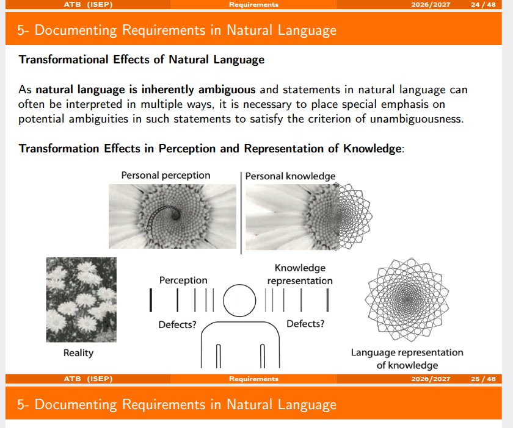

professor parou neste slide... modelo da realidade e a percepcao da pessoa cerebral !!!

algo que e descrito do algo visual para computacao temos de tre requisitos para conseguir com alguns processos. ! 

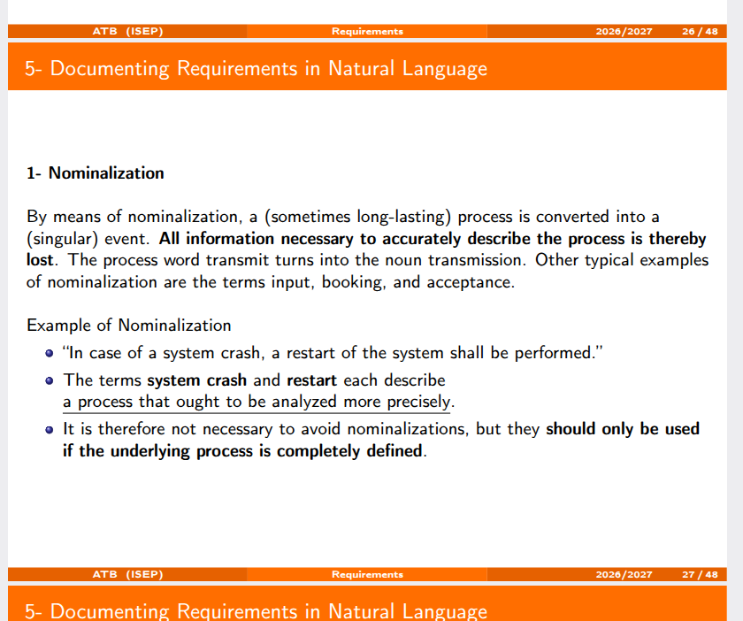

saber fazer o requirimentos de como fazer o restart ou nao das sessoes activas !!

nao deve ser ambigupo este tipo de requissitos .
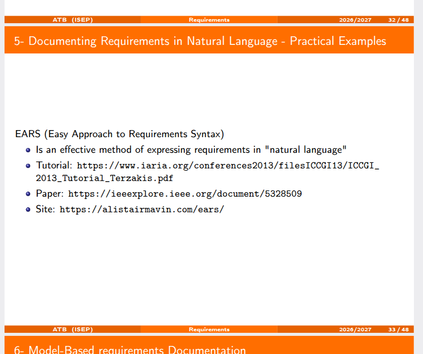
e um conjunto de tecnicas para escrever de uma forma simples... e alistair trabalham mutio tempo neste tipo de actividades !

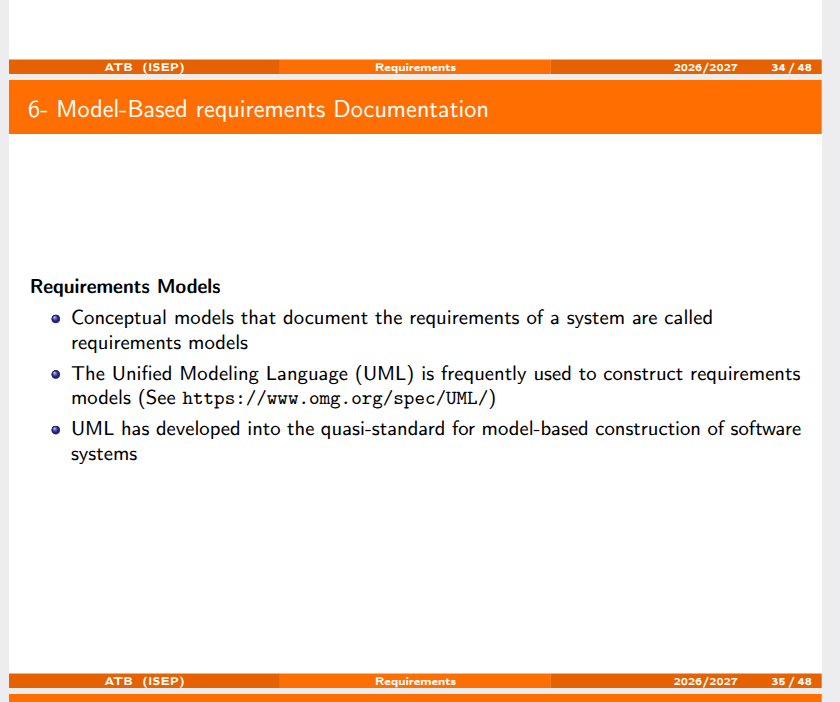

UML foi dos primeiros ,

UML para se ter ideia, em termos de modelo tem 300 classe cerca.. 

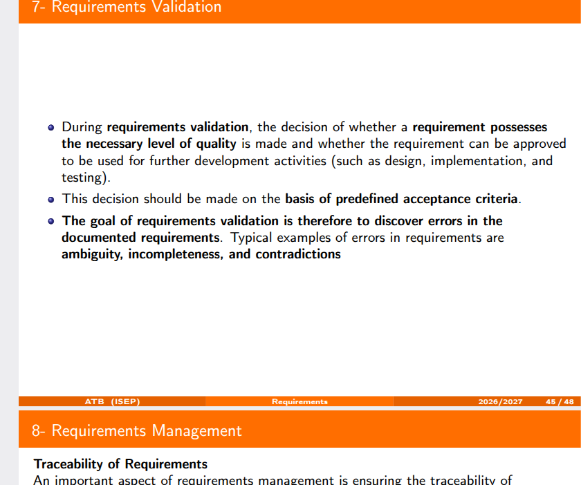

requisitos tem de ser validados !!!

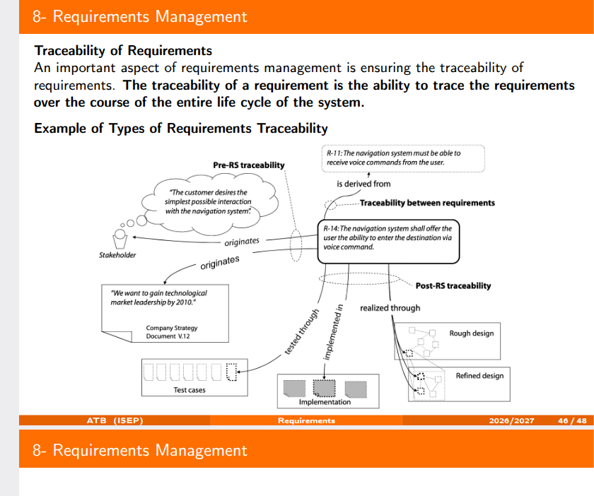

rastreabilidade !!!
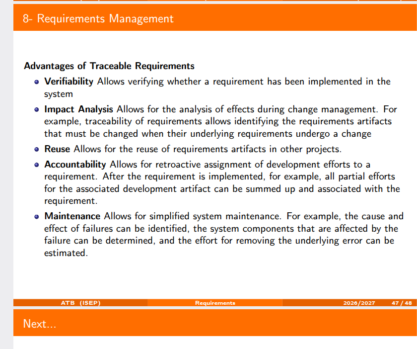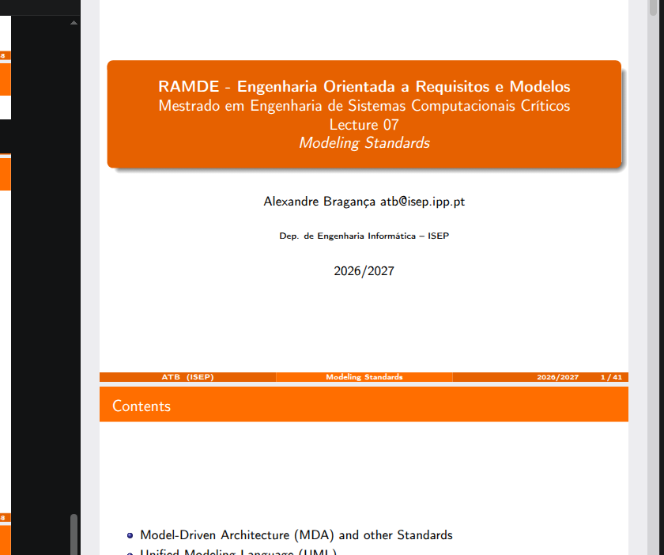

mudamos de powerpoint

no caso do eclipse exite um papaivirus open source - Papyrus. Eclipse Papyrus...

perspectiva de um metamodelo...

OMG promove standards de modelacao !!

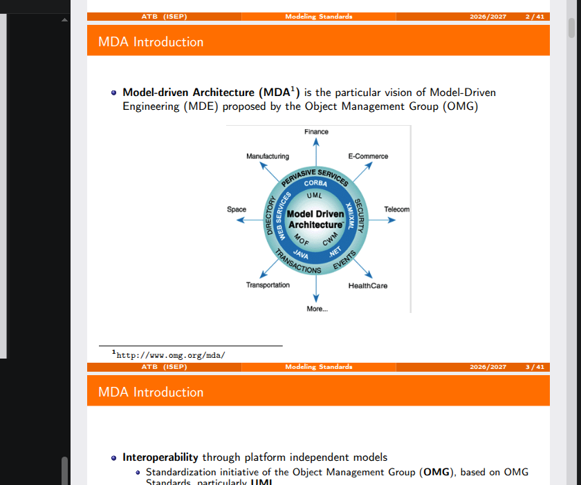

na base dito esta o mof,

QVT e uma linguagem de modelacao !!
model driven e tudo sao modelos !!
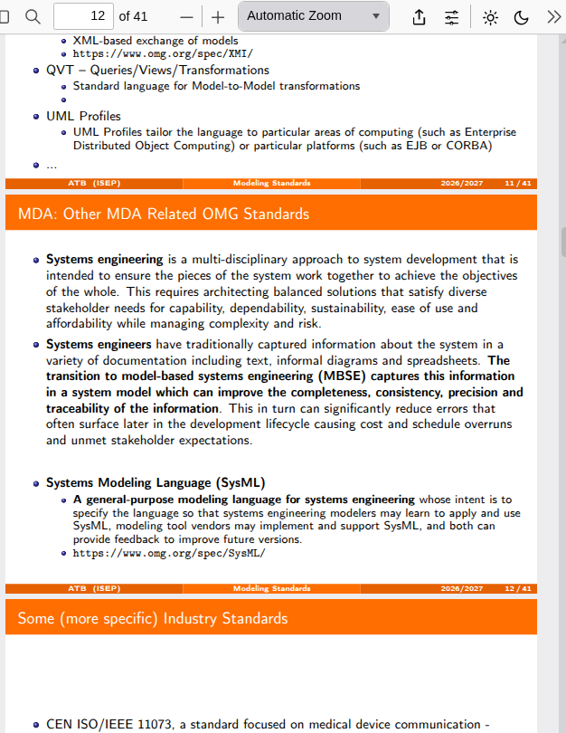

baseio me nos modelos mas muita coisa e feita manualmente !!!

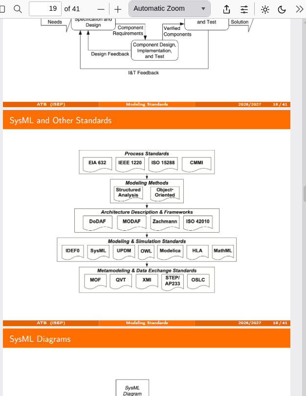

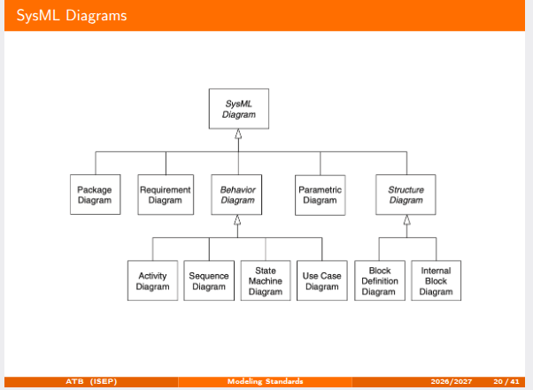

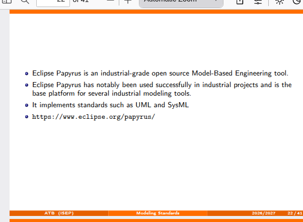

papyeus funcao opensource funciona bem ate 20.25.06

eclipse papiros fazer o download do executavel !!!

metamodelo vs

relacoes conceitos metamodelos, eclipse. implementacao do modelo

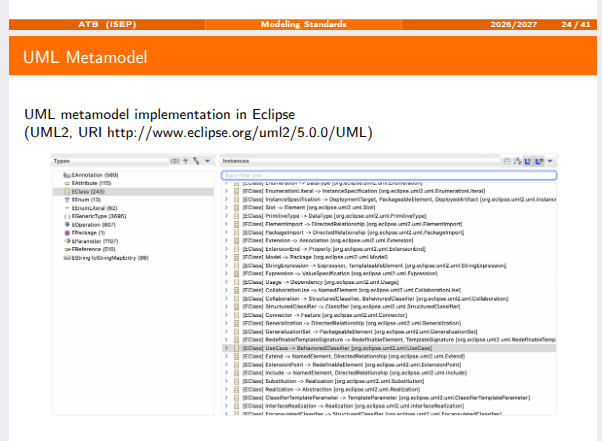

SYSml foi baseado no

kernel model language e tipo superclasses... 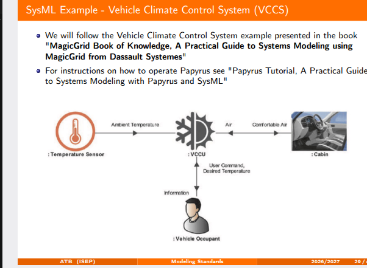

e um diagrama de contexto m a seguir vem requisitos !!

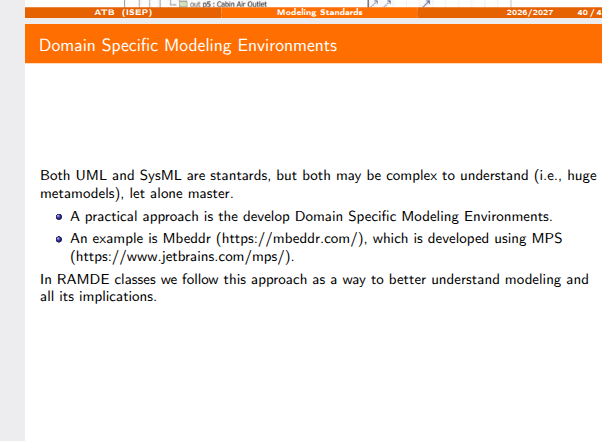
