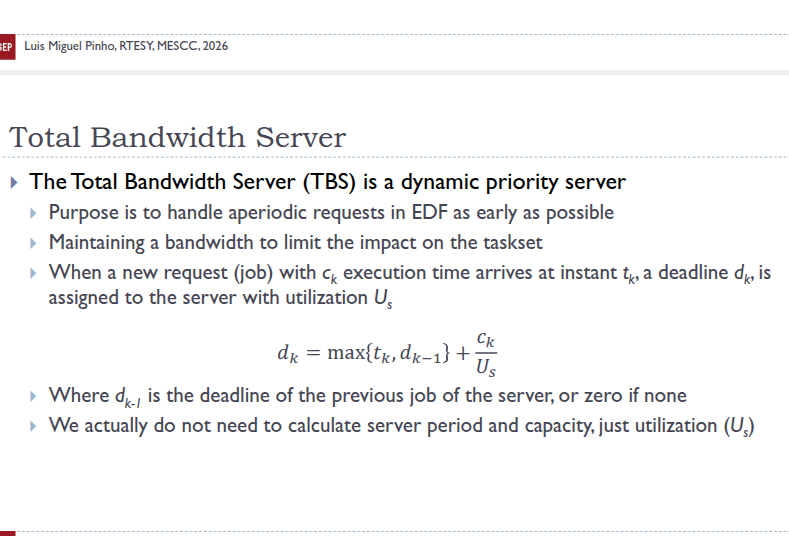
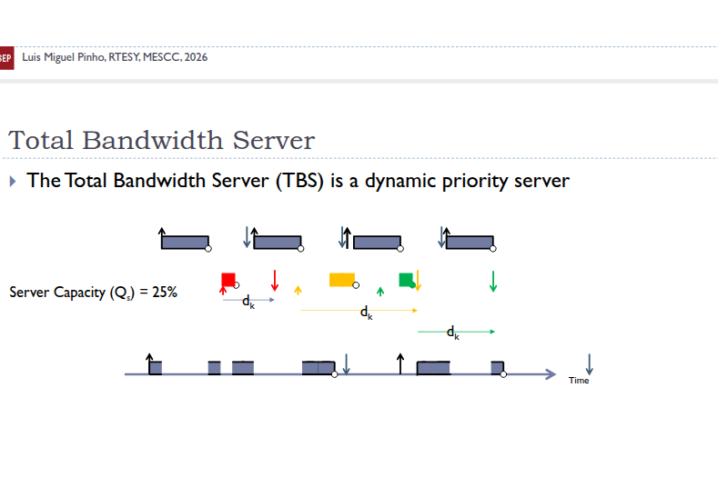
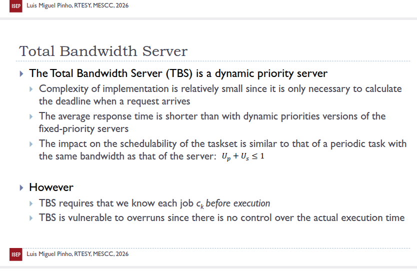
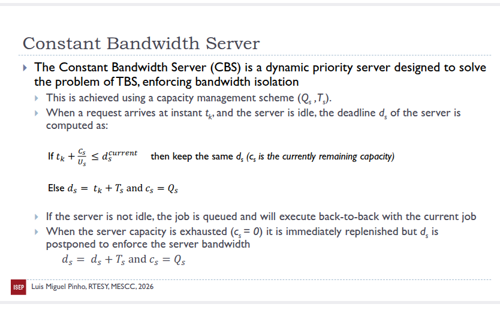
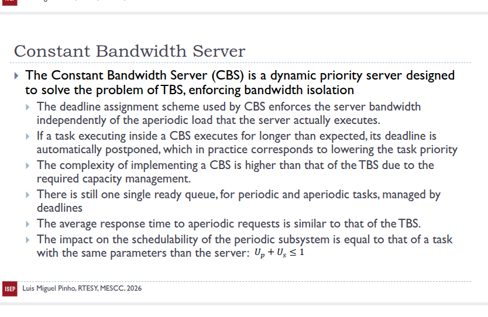

-

# servers rtesy 4

servidor capacidade de 3

Q = 3

t = 20

t - 4 e c -2

o deline iniciakl e 0.

d1 = 4 mais (2/(3/20)) utilizacao do servidor isto da 13.3333...

tenho que dar uma deadline para que garante que tenha tempo  ..

aqui o priofessor esta a falar no quadro e funcionamento de suso
edf aquela que vai executar e que tem o deadline mais perto !!

professor falar desta imagem agora

.a unica coisa que e diferente do edf normal tenho de rcaulcular o edf do servidor o  total bandwith server ...

total bandwidth server -> e sempre recalculado a deadline sempre que o job chegar ...

descvantagens quando faco calculo da deadline tenho de saber o tempo de excucao do job que chegou.... vou precisar de 2ms...

o servidor e quando as coisas sao mais dinamicas...

preciso de saber quanto tempo ira precisar , assim ..

o total band width server nao controla quando as tasks executam mais tempo e podem estragar o escalonamenteo nao controlo over runs....

qual e a outra solucao e constant bandwith server CBS

linux tudo e em cbs...
controlar over runs.... desliga se a task pomos a task IDLE...

para calular o nob=vo deadline , o intasnt em que chegoiu o job, mais  a capacidade

na teoria nauqel instante que chego a 0 , faco o replanishh do nudget e volto a permitir que a tarfa execute... 

deadleine vai

para os servidores nao tem deadline relativo , quando chega calculo deadline absoluto !!!

ver hard cbs nao vamos dar !!

no cbs tenhoond demanter regusto de quanto foi executado... tem overhead maior e o preco que se paga...

mais grantias mais overhead..

hard cbs ,

o linux com sched deadline..... na realidade nao e so edf, ele forca usem   e uma variante do grub, tem uma variacao desse cbs, mas a base e o cbs...  

# Exercicios
